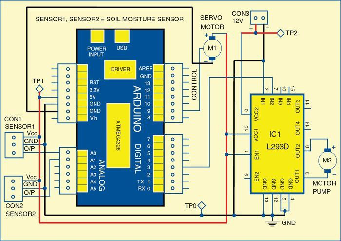

# Automated Multi-Pot Watering System — Arduino

**Embedded systems / Electric Circuits II · Arduino Uno · C++**

A sensor-controlled watering prototype for **two plant pots**. An Arduino reads each pot's soil-moisture sensor, points a servo-driven hose toward the selected pot, and activates a pump for a preset duration.

## Hardware used

- Arduino Uno
- Two soil-moisture sensor inputs (Arduino `A0` and `A1`)
- SG90 micro servo (`D9`)
- Water pump and driver (course report lists an **L293D**; pump control pin `D3`)
- Suitable, separately regulated supplies for the control electronics and pump

## Control logic

1. Read two analog moisture readings.
2. Compare each reading against a configurable sensor threshold (`600` in the supplied sketch).
3. If a pot needs watering, move the servo to its configured hose position, then run the pump for **5 s** (pot 1) or **8 s** (pot 2).
4. Return the servo to its home position and delay before the next decision.

The sketch uses blocking `delay()` calls and checks the pots sequentially; it is intended as a simple class prototype rather than a robust unattended irrigation controller.

## Run it

1. Open [`AutoWatering-SinaHemmati.ino`](AutoWatering-SinaHemmati.ino) in the **Arduino IDE**. Install the standard `Servo` library if required.
2. Select the **Arduino Uno** and correct serial port.
3. Confirm sensor pin assignments, servo angles, moisture polarity, and pump-driver wiring before connecting the pump.
4. Calibrate `threshold`, `plantpos1`, `plantpos2`, `wateringTime` and `wateringTime2` for your own setup.
5. Upload the sketch and observe moisture readings in the serial monitor at **9600 baud**.

**Electrical safety:** Do not power a pump directly from an Arduino I/O pin, and do not apply an unregulated supply to a 5 V pump. Use an appropriately rated driver and power supply with common ground where required.

## Notes

- The code's comments on `plantpos1`/`plantpos2` are not fully consistent with the named pot positions. **Check the actual angle values against your physical layout.**
- Soil-sensor polarity varies by sensor/module; test whether larger values actually indicate drier soil.
- `docs/report-redacted.pdf` contains the original Persian-language explanation and circuit drawing, with the student number removed.

**Author:** Sina Hemmati · B.Sc. Electrical Engineering (Telecommunications), K. N. Toosi University of Technology.
